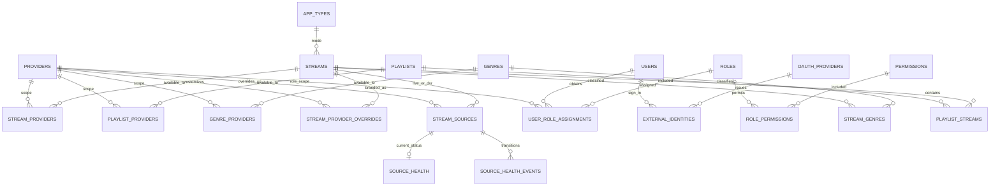
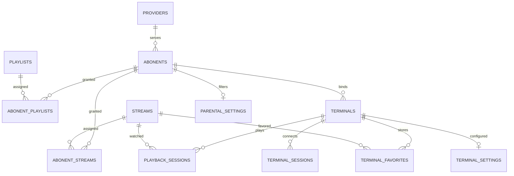
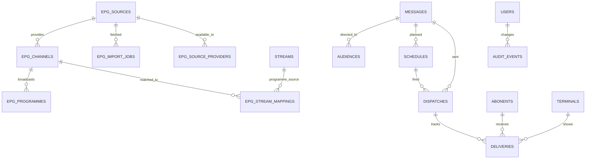

# IPTV: ER-модель v1.0

Здесь показаны основные связи. В полной БД есть дополнительные поля аудита, настройка доступа, вспомогательные индексы и связи, которые описаны в миграциях.

## Каталог, права администраторов, провайдеры

## Абоненты, устройства, доступы

## EPG, сообщения, аудит

### Правила доступа

- `visibility = 'all'`: ресурс доступен провайдерам; таблица связей для него не используется.
- `visibility = 'selected'`: ресурс доступен только провайдерам из `*_providers`. Если связей нет, ресурс не доступен никому (fail closed).
- Привязка плейлиста к абоненту не позволяет смотреть канал, который запрещён провайдеру; в клиентском каталоге используются пересечения всех прав.
- `playlist.is_public` означает видимость бесплатной публичной подборки. Доступ анонимного клиента к конкретному видео требует `streams.is_public = true`, `streams.enabled = true` и доступности потока провайдеру. Плейлист не снимает это ограничение.
- Права подписчика: действующий прямой `abonent_streams` ИЛИ включение в действующий `abonent_playlists` плюс ограничения канала, провайдера и родительского контроля.
- `is_hidden` влияет на поисковую выдачу, не отменяет выданных прав.
- Подробные сессии просмотров отключаемы независимо от количества допустимых параллельных просмотров.
